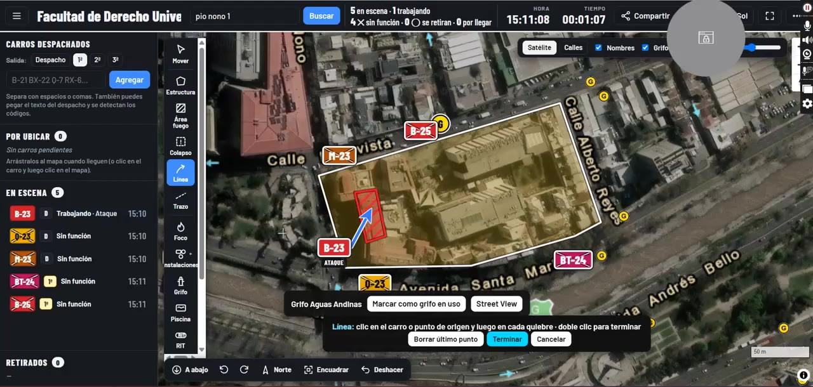

# Croquis PM · tablero del puesto de mando

**La pizarra queda libre para lo que solo cabe en la pizarra.** Croquis PM reemplaza el croquis dibujado a mano en el puesto de mando de bomberos por un mapa satelital. Los carros despachados se mueven como piezas de un juego de mesa, con su estado, función y lado. La pantalla grande del PM muestra la escena completa, y la pizarra física queda para el PAR y los detalles de un mayday.

- **Aplicación publicada:** https://lechugaluminio.github.io/Simulador-PM/
- **Video (60 s):** [docs/video.mp4](docs/video.mp4)
- Proyecto personal de [Lechugaluminio](https://github.com/Lechugaluminio). Pensado para el puesto de mando de bomberos (K-3, puesto de mando móvil).


*Prueba de funcionamiento: incidente en Las Enredaderas con Av. Fermín Vivaceta, Independencia.*

[](docs/video.mp4)

*Video de demostración (60 s). Clic en la imagen para verlo.*

---

## 1. Concepto

En un incendio, el oficial del puesto de mando dibuja en una pizarra un croquis con la cuadra afectada, los lados A, B, C y D, el fuego y cada carro que llega. Ese dibujo se borra y se rehace a cada cambio, ocupa la pizarra que se necesita para la contabilidad de personal y nadie más lo ve.

Croquis PM propone que **el croquis sea un tablero vivo**:

- **El mapa es real.** Se busca la dirección del despacho y aparecen la imagen satelital, los nombres de calles, la numeración y los **grifos** publicados por Aguas Andinas.
- **Los carros son piezas.** Se pegan los códigos del despacho y se arrastran al mapa cuando llegan. Cada pieza lleva su color por tipo, su estado, su función y la salida a la que pertenece.
- **Las convenciones son las de siempre.** ✕ = carro sin función o que no puede cumplirla; ◯ = carro retirándose; símbolos SCI para el Puesto de Comando, la zona de espera y el ACV. No hay que aprender un lenguaje nuevo.
- **Dos escalas, sin mezclar.** Como en dos pizarras: la vista **Territorio** muestra el despliegue urbano (carros, líneas de abastecimiento, zona de espera, PAP, PAS, ACV, calles cortadas) y la vista **Estructura** lo que pasa dentro del edificio (humo, fuego, víctimas confirmadas, muros con riesgo de colapso). Las líneas de ataque, con el pitón en la punta, se ven en las dos. Cada vista muestra solo sus herramientas y atenúa lo de la otra, para que el croquis no se vuelva una ensalada de información.
- **La información no sale del equipo.** Todo vive en el navegador del computador del PM. No pasa por servidores ajenos ni por grupos de mensajería durante la emergencia.

**Qué queremos lograr:** que todos en el puesto de mando lean de un vistazo dónde está cada recurso y qué está haciendo, y que el oficial deje de redibujar para dedicarse a decidir.

---

## 2. Cómo se usa

1. **Buscar el lugar.** Escribir la dirección o el cruce del despacho (por ejemplo `Las Enredaderas & Avenida Fermín Vivaceta, Independencia`) y pulsar *Buscar*.
2. **Dibujar la estructura.** Herramienta *Estructura*: clic en las esquinas. Los lados **A–D** se ponen solos; el botón **A abajo** orienta el mapa como en la pizarra.
3. **Marcar el fuego.** *Área fuego* (achurada), *Colapso*, *Foco*.
   En la vista **Estructura** (`Tab`) se agregan *Humo*, *Muro con riesgo* y *Víctima* (cantidad; al marcarla rescatada queda como un punto verde chico).
   *Línea de ataque*: del carro al pitón; **la punta de la línea es el pitón** (chorro, monitor o espuma) y lleva el diámetro (38, 45, 52 o 70 mm). En Territorio se ve solo el recorrido, sin rótulo.
   *Pisos*: en el panel de la estructura se indican pisos y subterráneos; aparece la columna de pisos junto al edificio (ver 3.4).
4. **Cargar el despacho.** Elegir la salida (despacho inicial, 1ª, 2ª o 3ª alarma), pegar los códigos (`B-21 BX-22 Q-7 RX-6…`) y pulsar *Agregar*. Quedan en **Por ubicar**.
5. **Ubicar los carros al llegar.** Arrastrarlos al mapa: queda registrada la hora de llegada. Clic en la pieza para asignar estado, función, lado y nota.
6. **Instalaciones y avisos.** En la vista **Territorio**: PC, zona de espera (E), ACV, PAP, PAS, *Línea de abastecimiento* (grifo → Z, PAP o PAS → bomba) y *Calle cortada*. Los grifos se marcan en uso o sin agua con un clic. RIT con la compañía a cargo y MAYDAY van en la vista Estructura.
7. **Mostrar.** *Presentación* para la pantalla grande del PM, o *Imagen* para copiar o descargar el croquis.
8. **Llevar a terreno.** Un ayudante escanea el QR y se lleva una copia editable al celular. Al volver, *Cambios* muestra qué se modificó.

---

## 3. Funcionamiento

### 3.1 Carros (piezas)

| Código | Tipo | Color de la pieza |
|---|---|---|
| `B` | Bomba | rojo |
| `BX` | Bomba 4x4 | naranja |
| `BM` | Bomba con escala telescópica | rojo oscuro |
| `BT` | Bomba tanker | frambuesa |
| `Q` | Porta escala | amarillo |
| `M` | Escala mecánica | café |
| `R` / `RX` | Rescate / rescate especializado | azul / celeste |
| `H` | Hazmat | verde |
| `Z` | Camión cisterna | turquesa |
| `K` / `K-3` | Comandancia / puesto de mando móvil | morado / amarillo |
| `X` | Telecomunicaciones, logística e investigación de incendios | gris |
| `S` | Ambulancia | blanco |

- **Carros de apoyo de otros cuerpos:** se aceptan con sufijo (`Z-3Ñ` = 3ª Cía. de Ñuñoa, `B-4QN` = Quinta Normal).
- **Salida:** cada pieza indica si llegó en el **despacho inicial, 1ª, 2ª o 3ª alarma**.
- **Colores y funciones:** se editan en *Ajustes*.

### 3.2 Estados

| Estado | Cómo se ve | Equivale en la pizarra a |
|---|---|---|
| Sin función | Pieza con **✕** | Carro con X |
| Trabajando | Pieza limpia, con su función (ataque, corte de propagación, abastecimiento, búsqueda y rescate, ventilación…) | Carro con su tarea anotada |
| No puede cumplir | Pieza con **✕** | Carro con X |
| Retirándose | Pieza con **◯** | Carro en círculo |
| Retirado | Pieza gris y tachada (se puede ocultar del mapa en *Ajustes*) | Carro borrado |

La barra superior resume la escena: cuántos están en escena, trabajando, sin función, retirándose y por llegar.

### 3.3 Dos vistas: Territorio y Estructura

| | Territorio (escala urbana) | Estructura (escala del edificio) |
|---|---|---|
| Para qué | Despliegue en la manzana: dónde está cada carro y cómo llega el agua | Qué pasa dentro del edificio afectado |
| Herramientas | Instalaciones (PC, E, ACV, PAP, PAS), línea de abastecimiento, calle cortada | Área fuego, colapso, humo, muro con riesgo, foco, víctima, RIT, MAYDAY |
| Lo de la otra vista | Oculto, incluidos el foco, el RIT, las notas y el MAYDAY resuelto que están dentro del edificio o asignados a un piso (afuera se siguen viendo; el MAYDAY activo y las víctimas confirmadas se ven siempre); cada estructura muestra un **resumen** (fuego, víctimas, humo, RIT) que lleva a la vista Estructura con un clic | Atenuado (carros e instalaciones al fondo) |
| Zoom | Se aleja solo para ver la manzana | Se acerca solo a la estructura |

Se cambia con las pestañas sobre el mapa o con `Tab`. La imagen exportada indica en qué vista se hizo. Estructura, **líneas de ataque**, trazo, texto y lados A–D están en ambas. En Territorio las líneas de ataque se ven sin rótulo ni tipo de pitón: alejando el mapa se sigue viendo dónde hay líneas y cuántas.

#### Edificios de varios pisos

El mapa muestra la planta (el techo), así que los pisos se resuelven como en la pizarra:

| Pieza | Cómo funciona |
|---|---|
| Pisos de la estructura | En su panel: pisos (1–99) y subterráneos |
| Piso de cada elemento | Víctimas, foco, MAYDAY, RIT, texto, fuego, humo, colapso, muro y líneas de ataque tienen botones de *Piso* (S1… P1, P2… Techo). En el mapa llevan la etiqueta `P2`, `S1` o `Techo` |
| Columna de pisos | Junto al edificio, en la vista Estructura: una fila por piso con **íconos** de lo que pasa en él: llama (fuego), nube (humo), víctima con su cantidad, línea con flecha (líneas trabajando, con cantidad), ventilador azul (inyecta) o gris (extrae), exutorio, triángulo (riesgo de colapso), pastilla RIT, víctimas rescatadas en verde, el texto de las notas de ese piso (por ejemplo *Red seca rota*) y pastilla MAYDAY. El **piso fuego −2** se marca solo con la etiqueta `F−2`: ahí se conecta la línea que sube al piso del fuego y espera el RIT. En edificios altos la lista se desplaza con la rueda del mouse y el botón ⤢ la abre completa; al abrirse muestra el piso con fuego. El botón del embudo deja solo los pisos con algo (los demás se resumen como `⋮ 5 pisos`) |
| Mover la columna | Se arrastra desde su encabezado negro y queda en ese lugar respecto del edificio, aunque se cambie de vista o de zoom; doble clic en el encabezado la devuelve a su lugar |
| Ver un piso | Clic en una fila: lo de los otros pisos se atenúa y lo que se agregue dentro del edificio queda en ese piso. *Ver todos* vuelve a mostrar todo |

La copia de terreno por QR, el respaldo `.json` y la imagen exportada incluyen los pisos.

### 3.4 Herramientas del croquis

| Herramienta | Tecla | Vista | Qué dibuja |
|---|---|---|---|
| Mover | `V` | ambas | Seleccionar y mover piezas y marcadores |
| Estructura | `E` | ambas | Polígono del edificio con lados A–D automáticos |
| Área fuego | `F` | Estructura | Zona con fuego, achurada en rojo |
| Colapso | `C` | Estructura | Zona de colapso |
| Humo | `U` | Estructura | Marcador de nube gris donde hay humo, con nota y piso (como el foco) |
| Ventilación | `W` | Estructura | Ventilador que **inyecta aire** (azul) o **extrae humo** (gris), con flecha hacia donde va el aire (al ponerlo apunta solo hacia el edificio o hacia afuera), o **exutorio abierto** (salida de humo arriba de la caja de escala). Lleva piso |
| Muro con riesgo | `M` | Estructura | Franja amarilla y negra sobre el muro con riesgo de colapso |
| Línea de ataque | `L` | ambas | Del carro al pitón. La punta es el pitón: flecha llena (chorro), doble (monitor) o hueca (espuma). Diámetro de 38, 45, 52 o 70 mm y color a elegir |
| Foco | `1` | Estructura | Llama en el punto de origen |
| Víctima | `X` | Estructura | Víctima confirmada con cantidad; al marcarla *rescatada* queda como un punto verde chico |
| MAYDAY | `5` | Estructura | Pastilla roja de MAYDAY en el lugar del bombero. Al marcarlo *resuelto* (bombero fuera) queda como una pastilla verde chica `✓ MAYDAY`, sin pulso |
| RIT | `6` | Estructura | Pastilla verde con la compañía a cargo |
| Puesto de Comando | `2` | Territorio | Rectángulo naranja con **PC** (estándar SCI) |
| Zona de espera | `7` | Territorio | Círculo amarillo con **E** |
| ACV | `8` | Territorio | Círculo amarillo: área de concentración de víctimas |
| PAP | `9` | Territorio | Círculo amarillo: puesto de abastecimiento primario |
| PAS | `0` | Territorio | Círculo amarillo: puesto de abastecimiento secundario |
| Línea de abastecimiento | `B` | Territorio | Línea azul oscuro gruesa con flecha: grifo → Z, PAP o PAS → bomba; diámetro de 75 o 110 mm |
| Calle cortada | `Q` | Territorio | Franja roja y blanca sobre la calle |
| Trazo | `K` | ambas | Trazo punteado libre |
| Texto | `T` | ambas | Rótulo libre |

Los marcadores (foco, humo, víctima, MAYDAY, RIT, texto e instalaciones) se ponen con clic en el botón y clic en el mapa, o **arrastrando el botón al mapa**, como los carros. Una vez puestos se mueven arrastrándolos.

Las medidas de mangueras y pitones van en milímetros, como en las guías de la Academia Nacional de Bomberos. Los croquis antiguos guardados en pulgadas se convierten solos al abrirlos (1½" → 38 mm, 2" → 52 mm, 2½" → 70 mm), y los pitones sueltos de versiones anteriores pasan a ser la punta de una línea corta. Las zonas de humo dibujadas como polígono pasan a ser un marcador de humo en su centro.

### 3.5 Mapa y datos externos

| Fuente | Qué aporta | Cuándo se consulta |
|---|---|---|
| Esri World Imagery | Imagen satelital | Al mover el mapa |
| Esri World Street Map | Mapa de calles (alternativa al satélite) | Al elegir *Calles* |
| Esri World Transportation | Nombres de calles y numeración sobre el satélite | Con *Nombres* activado |
| Nominatim (OpenStreetMap) | Búsqueda de direcciones | Al pulsar *Buscar* |
| Overpass (OpenStreetMap) | Ubicación exacta de un **cruce** de calles | Al buscar un cruce `Calle A & Calle B` |
| Aguas Andinas · *Ubicación de grifos* | Grifos de Aguas Andinas, Aguas Cordillera y Aguas Manquehue | Una vez por semana o desde *Menú → Actualizar grifos*; quedan guardados en el navegador |
| [Open-Meteo](https://open-meteo.com/) | Viento: velocidad, dirección y ráfagas a 10 m, y a 80, 120 y 180 m para edificios altos (pronóstico de modelos meteorológicos) | Al ubicar el incidente y cada 15 min; se pide con coordenadas redondeadas a ~1 km |

Clic en un grifo de Aguas Andinas para marcarlo **en uso** o **sin agua** (gris con una raya roja). Clic en un grifo marcado para cambiar su estado o desmarcarlo.

El control *Atenuar* oscurece el mapa para que las piezas resalten.

#### Viento

Abajo a la derecha del mapa hay una **rosa de los vientos**: la flecha azul muestra **hacia dónde va el viento** (y el humo), y al lado van la velocidad, de dónde viene y las ráfagas. Si hay un edificio de 8 pisos o más, se agrega el viento a la altura del edificio (80, 120 o 180 m), que suele ser bastante más fuerte. Es un pronóstico de modelos para el sector, no una medición en el lugar: entre edificios el viento cambia. Con clic se ve el detalle y se puede **anotar el viento observado** en el lugar, que pasa a mostrarse en vez del pronóstico (queda en la bitácora). Se puede ocultar en *Ajustes*.

### 3.6 Bitácora

La pestaña **Bitácora** (junto a *Carros*, arriba de la columna izquierda) es la línea de tiempo del incidente, con hora real y tiempo desde el inicio (T+). Se llena sola; nadie tiene que escribir más.

| Se anota sola | Ejemplo |
|---|---|
| Despacho y llegada de carros | `Despachados (1ª alarma): B-21, Q-7` · `B-21 llegó a escena` |
| Estado y función de cada carro | `B-21: Trabajando · Ataque` · `Q-7: Retirándose` |
| MAYDAY y víctimas | `MAYDAY · P19` · `MAYDAY resuelto · P19 · duró 12 min` · `2 víctimas rescatadas · P19` |
| Fuego, humo, ventilación, RIT, líneas e instalaciones | `Humo · P20` · `Ventilador inyectando aire · P1` · `Línea de ataque · 52 mm · B-1 · P18` |
| Notas de piso | `Nota: Red seca rota · P12` |

- **Anotar a mano:** una caja de texto y botones rápidos (*Fuego controlado*, *Fuego extinguido*, *PAR realizado*, *Se solicita apoyo*, *Corte de gas/luz*…).
- **Correcciones:** un cambio dentro del primer minuto corrige la misma línea (por ejemplo, elegir el piso justo después de poner el marcador). Lo que se **deshace** queda **tachado**, no se borra.
- **Filtros:** Todo, Críticos (MAYDAY, víctimas, riesgos), Carros y Notas. Clic en una línea lleva el mapa a ese lugar.
- **Exportar:** `.txt` para el parte o informe, o planilla `.csv`. La bitácora también va dentro del respaldo `.json`.
- **Recordatorio de PAR** (opcional, en *Ajustes*): cada 10, 15, 20 o 30 min aparece un aviso; *PAR realizado* lo anota y reinicia el plazo.

### 3.7 Compartir y respaldar

| Función | Qué hace |
|---|---|
| **Presentación** (`P`) | Vista limpia para la pantalla grande del PM |
| **Imagen** | Croquis en alta resolución (doble de la pantalla) con encabezado del incidente, hora y resumen; se copia para pegar o se descarga en `.jpg` |
| **Copia de terreno** | QR con una copia editable para el celular. Los datos viajan dentro del QR, en la parte `#` del enlace, que el navegador no envía a ningún servidor. La copia nunca modifica el croquis principal |
| **Cambios** | Al volver de terreno, lista lo modificado y muestra con líneas punteadas las posiciones originales |
| **Exportar croquis (.json)** | Respaldo completo del incidente |
| **Modo sol** (`S`) | Alto contraste para uso al exterior: piezas más grandes, líneas más gruesas y mapa con más contraste |

En celulares y tablets verticales, la lista de carros se abre como panel deslizable y las herramientas quedan en una barra inferior.

---

## 4. Créditos y autoría

| Elemento | Autor | Licencia / nota |
|---|---|---|
| Concepto, convenciones de la pizarra y decisiones de diseño | [Lechugaluminio](https://github.com/Lechugaluminio) | Proyecto propio, basado en su práctica en el puesto de mando |
| Código de la aplicación | [Lechugaluminio](https://github.com/Lechugaluminio) con asistencia de [Claude](https://anthropic.com) (Anthropic) | HTML, CSS y JavaScript en un solo archivo |
| Motor de mapa | [MapLibre GL JS](https://maplibre.org/) 4.7.1 | Licencia BSD-3-Clause |
| Códigos QR | [qrcode-generator](https://github.com/kazuhikoarase/qrcode-generator) 1.4.4, Kazuhiko Arase | Licencia MIT |
| Imagen satelital, mapa de calles y nombres | © Esri y sus proveedores | Servicios de teselas de ArcGIS Online, con atribución en el mapa |
| Búsqueda de direcciones y cruces, mapa sin conexión | © colaboradores de [OpenStreetMap](https://www.openstreetmap.org/copyright) (Nominatim, Overpass) | Datos ODbL |
| Grifos | Aguas Andinas · [Ubicación de grifos](https://www.aguasandinas.cl/web/aguasandinas/ubicacion-de-grifos) | Mapa público de la empresa |
| Viento | [Open-Meteo](https://open-meteo.com/) | Datos CC BY 4.0, API gratuita para uso no comercial |
| Íconos y símbolos (piezas, llama, PC, E, ACV, PAP, PAS, RIT, MAYDAY) | Dibujados con código (SVG y canvas) | Símbolos según el estándar SCI |

---

## 5. Reflexión

Este proyecto busca mejorar la visión de la escena desde el puesto de mando, la claridad de la información y su transmisión mediante funciones cooperativas.

No pretende ser un sistema panóptico. Se limita a las funciones que hoy se llevan a mano en la pizarra y las traslada al soporte digital, integrando la información de mapas y grifos.

Al ser de código abierto y funcionar en el navegador, busca evitar barreras de entrada y ser lo más accesible posible.

---

## 6. Ejecutar

### Usar la aplicación

- **En línea:** https://lechugaluminio.github.io/Simulador-PM/ (Chrome o Edge, en el computador del PM).
- **Pantalla grande:** botón *Presentación* (`P`) y pantalla completa.
- Se usa con **mouse**; el teclado es opcional.

### Atajos de teclado

| Tecla | Acción |
|---|---|
| `Tab` | Cambiar entre vista Territorio y Estructura |
| `V` | Mover / seleccionar |
| `E` `F` `C` | Estructura / Área fuego / Colapso |
| `U` `M` `W` | Humo / Muro con riesgo / Ventilación |
| `X` | Víctima |
| `B` `Q` | Línea de abastecimiento / Calle cortada |
| `L` `K` | Línea de ataque / Trazo |
| `1` `2` `5`…`0` | Foco, PC, MAYDAY, RIT, Zona de espera, ACV, PAP, PAS |
| `T` | Texto |
| `A` | Orientar con el lado A abajo |
| `N` | Norte arriba |
| `Z` | Encuadrar todo |
| `S` | Modo sol |
| `P` | Modo presentación |
| `Enter` / `Backspace` | Terminar el dibujo / quitar el último punto |
| `Supr` | Borrar lo seleccionado |
| `Ctrl+Z` | Deshacer |
| `Esc` | Cancelar la herramienta |
| `H` o `?` | Ayuda |

### Estructura del repositorio

```
index.html   ← la aplicación completa (lo que publica GitHub Pages)
local/       ← versión sin conexión para Windows (servidor local, mapa y buscador)
docs/        ← capturas y video de este README
.nojekyll    ← GitHub Pages sirve los archivos tal cual
```

**GitHub Pages:** *Settings → Pages → Deploy from a branch*, rama `main`, carpeta `/ (root)`.

---

### Versión sin conexión (Windows)

Para el computador del puesto de mando o del K-3: **Menú ⋯ → Descargar versión sin conexión (Windows)…** o directamente [CroquisPM-Windows.zip](https://github.com/Lechugaluminio/Simulador-PM/releases/download/sin-conexion/CroquisPM-Windows.zip).

| Qué guarda en el computador | Detalle |
|---|---|
| La app y sus librerías | Abre sin internet, en su propia ventana (`CroquisPM.exe`) |
| Grifos | Copia del mapa público de Aguas Andinas |
| Mapa local | Calles, nombres, numeración y edificios de OpenStreetMap de Santiago, Estación Central, Independencia, Recoleta, Renca, Providencia, Las Condes, Vitacura y Lo Barnechea, con ~1 km extra para despachos limítrofes |
| Buscador sin conexión | Direcciones (`Calle 1234`), cruces (`Calle A & Calle B`) y nombres de calles |

- Con internet usa el satélite como siempre; **sin internet cambia solo al mapa local** (botón *Sin conexión*).
- Mapa y grifos se **actualizan solos cada 7 días** con conexión, o desde *Menú → Actualizar mapa y grifos sin conexión*. GitHub rehace el mapa cada lunes (`.github/workflows/sin-conexion.yml`).
- Todo queda en la carpeta `datos/` junto al programa: para pasarlo a otro computador se copia la carpeta completa.
- La imagen satelital **no** se guarda: los términos de Esri no permiten descargarla para uso sin conexión.
- Código: `local/croquis_pm.py` (solo librería estándar de Python; también se puede abrir con *Iniciar con Python.bat*).

## Datos y privacidad

- Todo se guarda **solo en el navegador del equipo** (localStorage). Nada del incidente se sube a GitHub ni a otro servidor propio.
- Para respaldar: *Menú → Exportar croquis (.json)*.
- La aplicación sí consulta servicios públicos para el mapa, la búsqueda, los grifos y el viento (sección 3.5). Esas consultas llevan la zona del mapa o el texto buscado, no el croquis.
