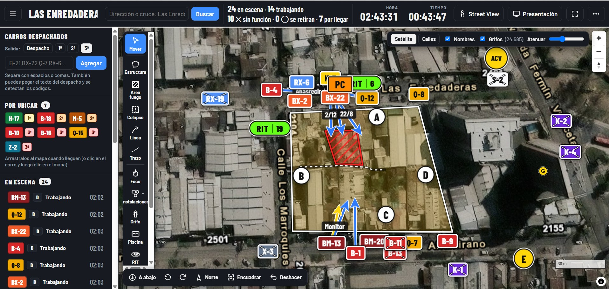

# Croquis PM

Tablero de mapa para el **puesto de mando** de bomberos: reemplaza el croquis de la pizarra por un mapa satelital donde los carros se mueven como piezas de un juego de mesa.

**Abrir:** https://lechugaluminio.github.io/Simulador-PM/

*Prueba de funcionamiento: incidente en Las Enredaderas con Av. Fermín Vivaceta, Independencia.*

## Qué hace

- Busca la dirección o el cruce del despacho (ej: `Las Enredaderas & Avenida Fermín Vivaceta, Independencia`) y centra el mapa.
- Satélite (Esri) con nombres de calles y numeración, o mapa de calles (Esri). Se puede atenuar para que las piezas resalten.
- Croquis: estructura con lados A–D automáticos (y botón **A abajo** para orientar como la pizarra), área con fuego achurada, zona de colapso, líneas con flecha, trazos, foco, grifos, piscinas, pastilla de MAYDAY y textos. **Instalaciones** con símbolos SCI: Puesto de Comando (PC), Zona de espera (E) y Área de concentración de víctimas (ACV).
- Carros: se pegan los códigos despachados, se arrastran al mapa al llegar (queda la hora) y se les asigna estado, función, lado y nota. Color por tipo (B, BX, BM, BT, Q, M, R, RX, H, Z, K, K-3, X, S), editable en *Ajustes*. Acepta carros de apoyo de otros cuerpos con sufijo (Z-3Ñ, B-4QN).
- Cada carro indica a qué salida pertenece: **despacho inicial, 1ª, 2ª o 3ª alarma**.
- Pastilla **RIT** (verde) con la compañía a cargo, y pastilla de **MAYDAY**.
- Mismas convenciones que la pizarra: **✕** = carro sin función o que no puede cumplirla, **◯** = carro retirándose.
- **Grifos automáticos:** se cargan desde el mapa público *Ubicación de grifos* de Aguas Andinas (Aguas Andinas, Aguas Cordillera y Aguas Manquehue) y se guardan en el navegador; se actualizan solos cada semana o desde *Menú → Actualizar grifos*.
- **Imagen** del croquis en alta resolución (doble de la pantalla) con encabezado de incidente, hora y resumen: se copia para pegar en WhatsApp Web / correo, o se descarga en .jpg.
- **Copia de terreno (celular):** el ayudante escanea un QR en el puesto de comando y se lleva una copia editable del croquis. En terreno ajusta carros, estados y marcadores; al volver, el botón **Cambios** lista lo modificado y muestra en el mapa las posiciones originales con líneas punteadas para ajustar la pantalla principal. Los datos viajan dentro del QR (en la parte `#` del enlace, que no se envía a ningún servidor) y la copia nunca modifica el croquis principal.
- **Pantallas chicas:** en celular y tablet vertical la lista de carros se abre como panel deslizable y las herramientas quedan en una barra inferior.
- Modo presentación para la pantalla grande, contador de tiempo del incidente, Street View.
- Se usa con mouse; el teclado es opcional (atajos en *Menú → Ayuda*).

## Datos

Todo se guarda **solo en el navegador del equipo** (localStorage). Nada del incidente se sube a GitHub. Para respaldar, *Menú → Exportar croquis (.json)*.

Necesita internet para el mapa y la búsqueda (Nominatim / Overpass de OpenStreetMap).

## Créditos

Imágenes y nombres de calles © Esri · Grifos: Aguas Andinas · Mapa: MapLibre GL JS.
